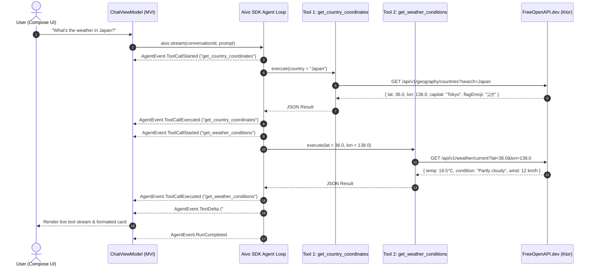

# 🌤️ Aivo Weather Agent — Kotlin Multiplatform Demo

[](https://github.com/Abdallah-Elsobky/Aivo-SDK)
[](https://kotlinlang.org/docs/multiplatform.html)
[](https://www.jetbrains.com/lp/compose-multiplatform/)
[](LICENSE)

> A production-ready **Kotlin Multiplatform (Android & iOS)** showcase demonstrating how to build autonomous, multi-turn AI agents using **[Aivo SDK](https://github.com/Abdallah-Elsobky/Aivo-SDK)**. 

The demo features an autonomous **Weather Assistant Agent** that orchestrates multiple live HTTP tools in real-time, executing sequential reasoning steps to resolve geographical coordinates and current weather conditions for any country on Earth.

---

</p>

## 📌 Project Overview

This application serves as an official reference implementation for integrating the **Aivo SDK** into modern cross-platform mobile apps.

Instead of writing manual `while(true)` loops, hardcoded function parsers, or fragmented platform code, this project demonstrates how Aivo SDK manages the complete **Agent Execution Cycle**:

* 🤖 **Autonomous Tool Invocation**: The agent independently decides when and which tools to call.
* 🔗 **Chained Multi-Tool Orchestration**: Calls `get_country_coordinates` first, extracts the latitude and longitude, and subsequently passes them to `get_weather_conditions`.
* ⚡ **Reactive Flow Streaming**: Emits live tool call milestones, reasoning states, and token deltas directly into a reactive MVI UI.
* 🎨 **Material 3 UI**: Clean, responsive light-themed chat interface with expandable multi-line input (1–3 lines with internal scroll) and status indicators.
* 🛡️ **Graceful Fallback Mechanism**: Built-in direct tool execution fallback if the remote LLM provider is temporarily unreachable.

---

## 🏗️ Architecture & Flow



### 🧩 Registered Live Tools

Both tools are defined using the declarative `tool(...)` DSL provided by `com.aivo.sdk.runtime.tool.*` in [`WeatherTools.kt`](shared/src/commonMain/kotlin/com/example/test_sdk/agent/WeatherTools.kt):

| Tool Identifier | Description | Parameter(s) | Output |
| :--- | :--- | :--- | :--- |
| `get_country_coordinates` | Retrieves geographic coordinates, official name, capital, and flag emoji. | `country: String` | `{ country, officialName, capital, latitude, longitude, flagEmoji }` |
| `get_weather_conditions` | Retrieves real-time weather metrics by coordinates. | `lat: Double`, `lon: Double` | `{ temperatureC, apparentTemperatureC, condition, windSpeedKmh, precipitationMm }` |

---

## 🔑 API Keys & Configuration

To run and test this demo app, you must **generate your own personal API keys** from the services below and paste them into your `local.properties` file:

### 1. FreeOpenAPI Weather API Key
* **Service**: Powers the geography search and live weather forecast tools.
* **Website**: [https://freeopenapi.dev/](https://freeopenapi.dev/)
* **How to generate your key**:
1. Visit [Free Open API](https://freeopenapi.dev/) and enter your email address to request an API key.
2. Check your inbox for the email containing your API key. If you can't find it, check your spam or junk folder.
3. Copy the API key and add it to your `local.properties` file under the `WEATHER_API_KEY` property.

### 2. Ollama API Key
* **Service**: Powers the autonomous LLM agent reasoning loop.
* **Website**: [https://ollama.com/](https://ollama.com/)
* **How to generate your key**:
  1. Go to [https://ollama.com/](https://ollama.com/) and create or sign in to your account.
  2. Navigate to your account settings / API keys to generate your personal API key.
  3. Copy your key and paste it into `local.properties` under `OLLAMA_API_KEY`.
  > **Tip for Local Ollama**: If you are hosting a local Ollama server (e.g. at `http://localhost:11434`), you may leave `OLLAMA_API_KEY` empty or use any placeholder value.

---

### ⚙️ Setting up `local.properties`

1. Copy [`local.properties.example`](local.properties.example) or create a file named `local.properties` in the root directory:
   ```bash
   cp local.properties.example local.properties
   ```
2. Open `local.properties` and replace the placeholder values with the keys you generated:

```properties
## Android SDK Path
sdk.dir=C\:\\Users\\<YourUsername>\\AppData\\Local\\Android\\Sdk

## FreeOpenAPI Weather Key (https://freeopenapi.dev/)
WEATHER_API_KEY=your_weather_api_key_here

## Ollama API Key (https://ollama.com/)
OLLAMA_API_KEY=your_ollama_api_key_here
```

> **Important Notes:**
> * **No Quotes**: Do **not** wrap your keys in quotation marks (e.g., use `WEATHER_API_KEY=foa_abc123`, not `WEATHER_API_KEY="foa_abc123"`).
> * **Automatic Code Generation**: The custom Gradle task `generateBuildConfig` automatically injects these keys into `com.example.test_sdk.config.BuildConfig` at build time.
> * **Security**: `local.properties` is included in `.gitignore` so your private keys will never be committed to source control.

---

## 🚀 Building & Running

### Prerequisites
* **JDK 17** or higher
* **Android Studio Ladybug** (or newer) with Compose Multiplatform support
* **Xcode 15+** (if building for iOS on macOS)

### Android
You can run the Android app directly from Android Studio using the `androidApp` run configuration, or via command line:

```bash
# Build Debug APK
./gradlew :androidApp:assembleDebug

# Install on a connected device/emulator
./gradlew :androidApp:installDebug
```

### iOS
1. Open the project in Xcode:
   ```bash
   open iosApp/iosApp.xcodeproj
   ```
2. Select your target simulator (e.g., iPhone 16) and click **Run** (`Cmd + R`).

---

## 📁 Project Structure

```
├── androidApp/                       # Android application launcher & Manifest
│   └── src/main/kotlin/.../          # MainActivity (Edge-to-Edge)
├── iosApp/                           # iOS application entry point (SwiftUI)
├── shared/                           # Shared Kotlin Multiplatform Module
│   └── src/commonMain/kotlin/.../
│       ├── agent/                    # Aivo SDK agent configuration & tools
│       │   ├── WeatherAgentFactory.kt# Sdk builder, agent definitions & runtime limits
│       │   └── WeatherTools.kt       # Tool 1 (Coordinates) & Tool 2 (Weather) DSL
│       ├── config/                   # Generated BuildConfig from local.properties
│       ├── data/                     # Data models and Ktor HTTP remote service
│       │   ├── model/                # CountryLocation, WeatherReport, DTOs
│       │   └── network/              # WeatherRemoteService (Ktor Client)
│       ├── presentation/             # MVI Architecture
│       │   ├── ChatState.kt          # UI State & Intents
│       │   ├── ChatViewModel.kt      # Agent execution & fallback orchestration
│       │   └── ui/
│       │       └── ChatScreen.kt     # Compose Multiplatform Chat UI
│       └── App.kt                    # Material 3 light theme entry point
├── build.gradle.kts                  # Root Gradle build script
├── gradle.properties                 # KMP & Compose build configurations
└── local.properties.example          # Template configuration for environment keys
```

---

## 🧠 How Aivo SDK Works in This Project

### 1. Declaring Tools with Strong Typing
```kotlin
val coordsTool = tool("get_country_coordinates", "Get coordinates by country name") {
    param("country", "Name of the country", ParamType.String, required = true)
    execute { args ->
        val countryName = args.string("country")
        val location = service.getCountryCoordinates(countryName)
        buildJsonObject {
            put("latitude", location.latitude)
            put("longitude", location.longitude)
        }
    }
}
```

### 2. Defining the Autonomous Agent Loop
```kotlin
val aivo = AivoSdk {
    providers {
        ollama("ollama") {
            apiKey(BuildConfig.OLLAMA_API_KEY)
        }
    }
    defaultModel("ollama:gpt-oss:120b")

    tools {
        register(coordsTool)
        register(weatherTool)
    }

    agents {
        define("weather_assistant") {
            systemPrompt = "You are a weather assistant. Always fetch coordinates first, then fetch weather conditions."
            tools(coordsTool, weatherTool)
        }
    }

    entryAgent("weather_assistant")
    runtime { maxSteps = 8 }
}
```

### 3. Consuming Live Events in UI
```kotlin
aivo.stream(conversationId, userPrompt).collect { event ->
    when (event) {
        is AgentEvent.ToolCallStarted -> updateStatus("Executing ${event.toolName}...")
        is AgentEvent.TextDelta       -> appendStreamingToken(event.text)
        is AgentEvent.RunCompleted    -> finishLoading()
        is AgentEvent.RunFailed       -> showError(event.error.message)
    }
}
```

---

## 🔗 Useful Links & References

* 🌐 **[Aivo SDK Documentation](https://abdallah-elsobky.github.io/Aivo-SDK/)**
* 📦 **[Aivo SDK GitHub Repository](https://github.com/Abdallah-Elsobky/Aivo-SDK)**
* 🦙 **[Ollama Platform](https://ollama.com/)**
* 🌍 **[FreeOpenAPI.dev API Documentation](https://freeopenapi.dev/Docs)**
* 🚀 **[Kotlin Multiplatform](https://kotlinlang.org/docs/multiplatform.html)**
* 🎨 **[Compose Multiplatform](https://www.jetbrains.com/lp/compose-multiplatform/)**

---

## 📄 License

This demo application is open-source and available under the [Apache 2.0 License](LICENSE).